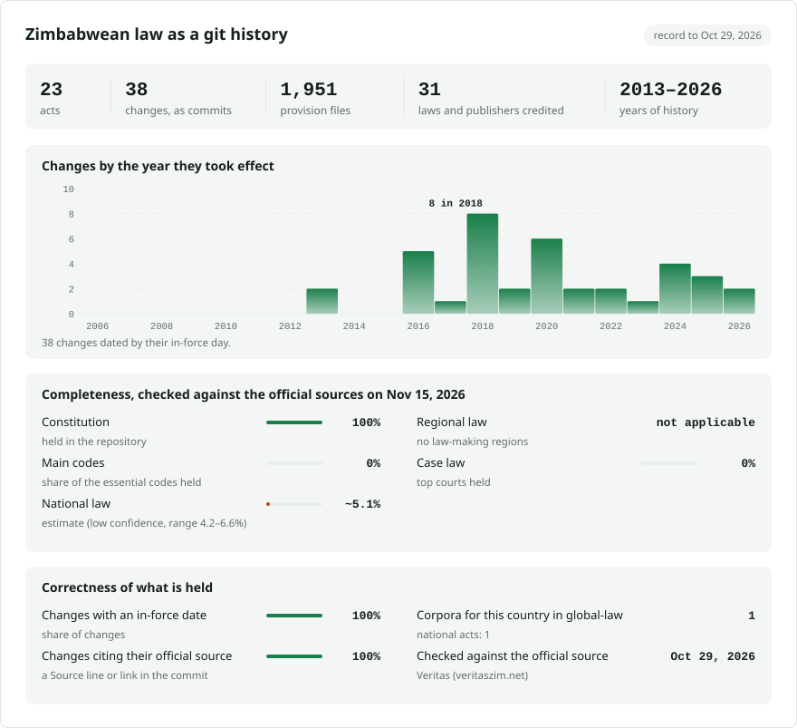

# Zimbabwe: law history in git

<picture>
<source media="(prefers-color-scheme: dark)" srcset="data/effort-dark.svg">

</picture>

The law of Zimbabwe as a git history: one file per section, one commit per version on the day it took effect, and the law that made each change as the commit's author. `git blame` names the law behind every paragraph; `git log` lists every change to a section; picking a date gives the text in force that day.

Part of [lexifina/global-law](https://github.com/lexifina/global-law), one git history for every country's law: this is Zimbabwe's national law, which global-law reads at `zimbabwe/national/acts/`.

**What is in it now:** the Constitution and 22 other Acts, with 39 versions from 22 May 2013 to 28 July 2026. The Constitution has 9 versions, up to Amendment No. 3 of 2026; seven of the other Acts carry an amendment made by a later law (2018 to 2025), and the other 15 have one version each. [`REPRODUCE.md`](REPRODUCE.md) lists every act with its versions; [`data/laws.csv`](data/laws.csv) lists every law it names, with its dates.

Each act is a folder named after its short title, with one file per section, Schedule or Schedule paragraph, and a `README.md` listing its provisions and their changes (`constitution/sec-180.md` is section 180 of the Constitution, on the appointment of judges).

The text is in English, as Veritas and ZimLII publish it (the English text of the Constitution prevails over any other, section 345); editorial notes and the Part and Chapter headings are left out.

## Questions as git commands

| Question | Command |
| --- | --- |
| Every change to section 180 of the Constitution | `git log -p --word-diff -- constitution/sec-180.md` |
| Which law wrote each line of section 180? | `git blame constitution/sec-180.md` |
| Every version of the Constitution that changed its words, with the day each took effect | `git log --format="%h %(trailers:key=In-force,valueonly,separator=) %an" -- constitution ':!constitution/README.md'` |
| Section 180 as in force on 1 January 2017 | `python tools/on.py 2017-01-01 constitution sec-180` |

**Outside git**, we also host this record publicly, for free:

- **[Ask Claude about Zimbabwean law](https://global-law.lexifina.com/v1/try_claude?country=zimbabwe)**: opens Claude with a first question ready.
- **[Ask ChatGPT](https://global-law.lexifina.com/v1/try_chatgpt?country=zimbabwe)**: the same question in ChatGPT.
- **[Search Zimbabwean law on our site](https://lexifina.com/law?country=zimbabwe&q=freedom+of+expression)**: a search for "freedom of expression", with each provision's text and its versions, no account needed.
- **[Developer REST API](https://global-law.lexifina.com/v1/search_law?query=freedom+of+expression&jurisdiction=zimbabwe)**: the same search as JSON, with no key. See the [documentation here](https://lexifina.com/api/global-law).

Both assistants read the record through the free Global law connector (MCP, `https://global-law.lexifina.com/mcp`); the first time, the chat gives you the link that adds it. Ask in English.

**Host it yourself easily.** All it takes is git and Python, and the tools run on your machine:

```sh
git clone --depth 1 https://github.com/lexifina/global-law && cd global-law
python3 tools/countries.py add zimbabwe/national/acts
python3 tools/law.py show 2026-01-01 zimbabwe/national/acts/constitution/sec-180.md
```

Opened in Claude Code, Cursor, VS Code or Codex, the clone also starts a local MCP server with the same tools ([MCP.md](https://github.com/lexifina/global-law/blob/main/MCP.md)).

## Dates

Each commit is dated at noon, Africa/Harare, on the day the version took effect, and carries it in its `In-force:` trailer:

- for an amendment of the Constitution, the commencement date in the amendment table of Veritas's consolidations (Act 10 of 2017: 7 September 2017; Act 2 of 2021: 7 May 2021; Act 6 of 2026: 7 July 2026), and for the Law Reviser's two corrections (SI 114 of 2023, SI 117 of 2026), the day of the Gazette that published them;
- the Constitution was published on 22 May 2013, when the parts listed in paragraph 3(1) of its Sixth Schedule came into operation, and the rest came into operation on 22 August 2013; that second version, and the Constitutional Court's judgment in *Gonese v Parliament* (CCZ 4/20, 31 March 2020), change no words, so `git log -- constitution` does not list them;
- for the other Acts, ZimLII's date for each point-in-time version: an amendment's commencement, and for an act as enacted its publication, or the commencement day ZimLII states where that is later (the Coroner's Office Act, 2019, published on 6 March 2020, is dated 5 September 2024).

Each change is credited to the law the source names for it: for the Constitution, the law Veritas's note under the changed provision names ("[Subsection amended by s. 3 of Act No. 2 of 2021]"); for the other Acts, the amending law ZimLII's History names (`Act 7 of 2024`), or one its editorial note names. Five differences in Veritas's 2018 consolidation that no note explains are credited to the publisher and dated 30 September 2018. The first version of the Constitution and of 16 other Acts is the act as enacted, credited to the act itself; for the other 6 it is the "oldest version available", credited to `ZimLII`.

## How it is checked

- `tools/check_repo.py` reads every version back from git on the day it took effect and on the day before, and compares it with the corpus: 39 versions of 23 acts, 0 mismatches (see [`REPRODUCE.md`](REPRODUCE.md)).
- The Constitution's last version is, provision for provision, Veritas's consolidation as amended up to 28 July 2026, the newest it publishes; replaying the credited changes on each consolidation gives the next one exactly.
- Every ZimLII version is parsed from an archived copy of its own point-in-time page, whose sha256 is recorded in `tools/sources.json`, `tools/batch2/` or `tools/batch3/`; the newest version of each act lists no amendment ZimLII has not yet applied.
- History is append-only: no merge commits and no commit date that goes backwards.

## What it does not show

- **Most Zimbabwean law.** Only these 23 acts: no other subsidiary legislation and no case law. Acts that ZimLII still carries only at the Law Development Commission's consolidation as at 31 December 2016 are left out, as a 2016 text cannot be taken as today's law without a check.
- **The Criminal Law (Codification and Reform) Act**, which is only on the `preview` branch (3 versions, 2017 to 2022): ZimLII has not applied two 2024 amendments, so its newest version is not today's law.
- **Changes before the oldest version.** Five acts start at that 2016 consolidation, which already holds the earlier amendments, and the Public Finance Management Act at 14 March 2018.
- **The Constitution beyond Veritas's five editions** (as enacted, and as amended up to 30 September 2018, 7 May 2021, 20 June 2023 and 28 July 2026). The five unexplained 2018 differences may be corrections of errors in one of Veritas's texts; nothing in the sources says which.
- **Validity.** Veritas notes that all three amending Acts have been challenged in the Constitutional Court and considers them invalid; this history follows the text as published and applied, and takes no view.
- **Changes within a line.** Each paragraph is one line, so blame credits a whole paragraph; use `git log -p --word-diff` for the words.

## Sources

| Source | Kind | Past versions | Notes |
| --- | --- | --- | --- |
| [Veritas](https://www.veritaszim.net/node/8104) | Non-profit publisher: the Constitution as enacted and consolidated | yes, five dated editions | The text, dates and credits of every version, from the amendment tables and the notes under amended provisions |
| [Veritas: Acts and statutory instruments](https://www.veritaszim.net/statutoryinst) | Acts and notices as published | as published | Act 6 of 2026, SI 117 of 2026 and the list of 2023 statutory instruments, for dating the corrections and checking s. 180 |
| [ZimLII](https://zimlii.org) (on the Laws.Africa Peachjam platform) | Legal information institute: consolidated acts | yes, each dated point-in-time version | The text, the day each version took effect, the History and editorial notes of the other 22 Acts |
| [Internet Archive](https://web.archive.org) and other web archives | Archived copies of ZimLII's pages | as archived | Every ZimLII page was read from an archived copy |

## Licence

See [`LICENSE`](LICENSE). The Constitution's text is Veritas's, under CC BY-NC-SA 4.0, and its files are shared under the same licence; the other Acts are ZimLII's, under CC BY-NC 4.0 with ZimLII credited as the source. The texts may be used only for non-commercial purposes; neither Veritas, ZimLII nor Laws.Africa endorses this repository. Lexifina's commit messages, tables and tools are CC0 1.0.

No AI model wrote, translated or corrected legal text, and none runs at build time; the scripts were written by an AI model (see [`REPRODUCE.md`](REPRODUCE.md)).

## More

From [lexifina/global-law](https://github.com/lexifina/global-law):

- [FEATURES.md](https://github.com/lexifina/global-law/blob/main/FEATURES.md): every feature, and what every corpus must support (`git blame`, `law.py`, the MCP tools)
- [FAQ.md](https://github.com/lexifina/global-law/blob/main/FAQ.md): questions and answers · [CONTRIBUTING.md](https://github.com/lexifina/global-law/blob/main/CONTRIBUTING.md): proposing changes · [MCP.md](https://github.com/lexifina/global-law/blob/main/MCP.md): the MCP server · [REPRODUCE.md](https://github.com/lexifina/global-law/blob/main/REPRODUCE.md): how it was built · [CHANGELOG.md](https://github.com/lexifina/global-law/blob/main/CHANGELOG.md)
- [FRESHNESS.md](https://github.com/lexifina/global-law/blob/main/FRESHNESS.md): how current each corpus is · [Monitoring](https://github.com/lexifina/global-law/tree/main/monitoring): whether updates are running · [WATCHING.md](https://github.com/lexifina/global-law/blob/main/WATCHING.md): how each official source is watched for changes
- [performance/](https://github.com/lexifina/global-law/tree/main/performance): how fast the tools are, measured
- [visualisations/](https://github.com/lexifina/global-law/tree/main/visualisations): charts and bridges across the world's law
- [Vulnerabilities](https://github.com/lexifina/global-law/tree/main/vulnerabilities): mistakes in legislation as published
